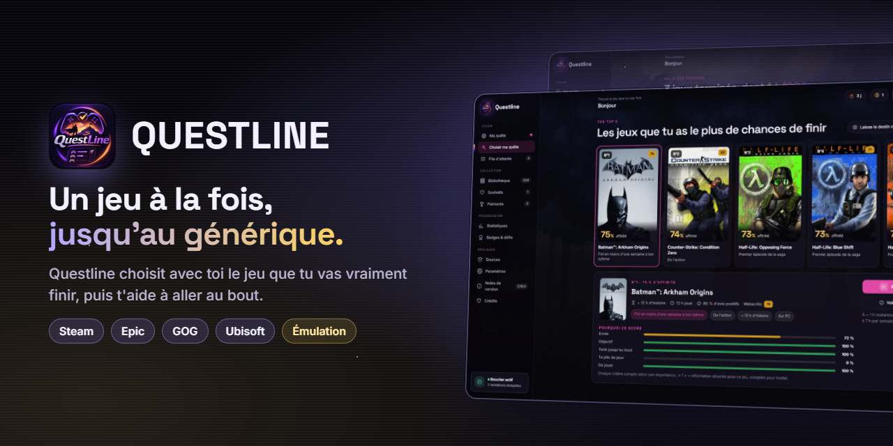
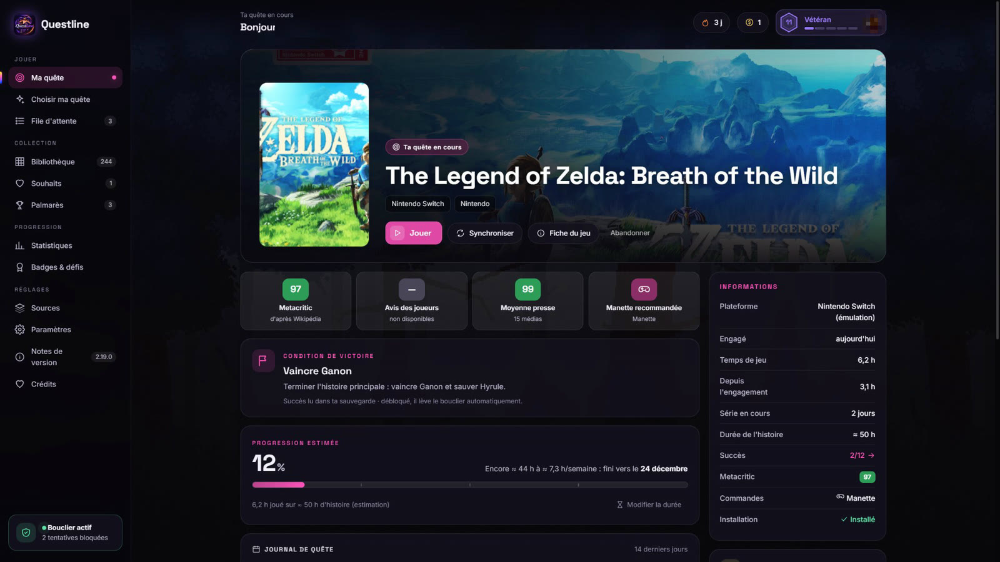
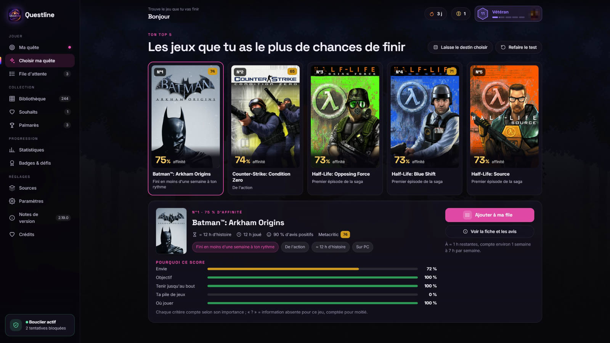
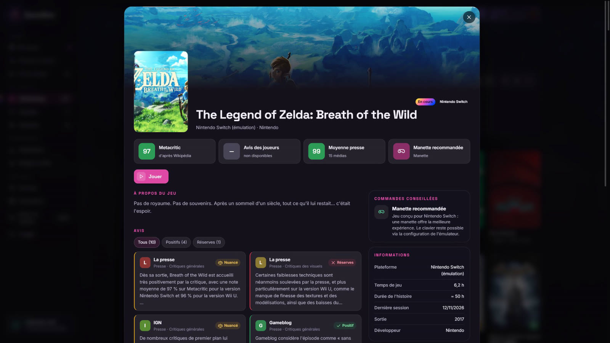
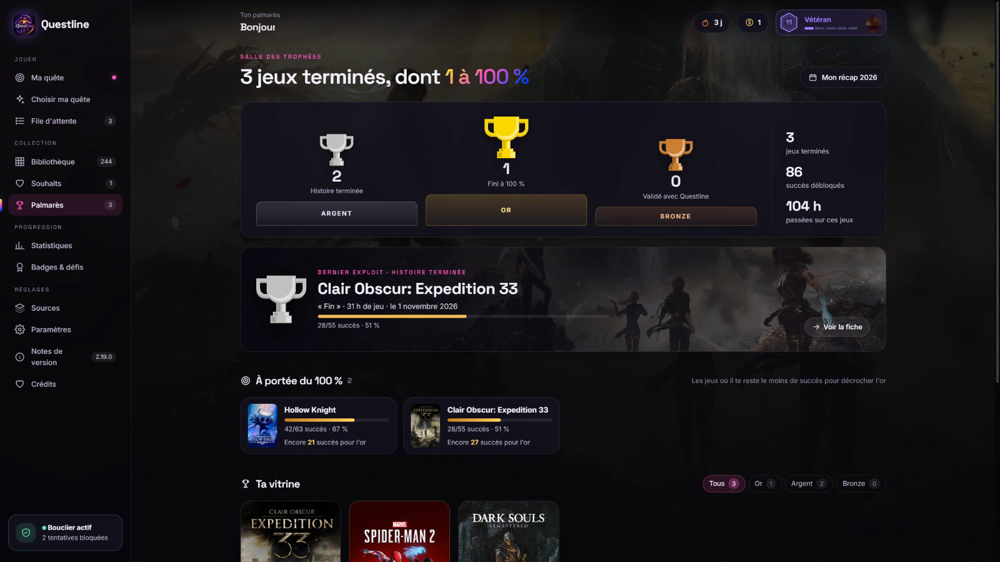
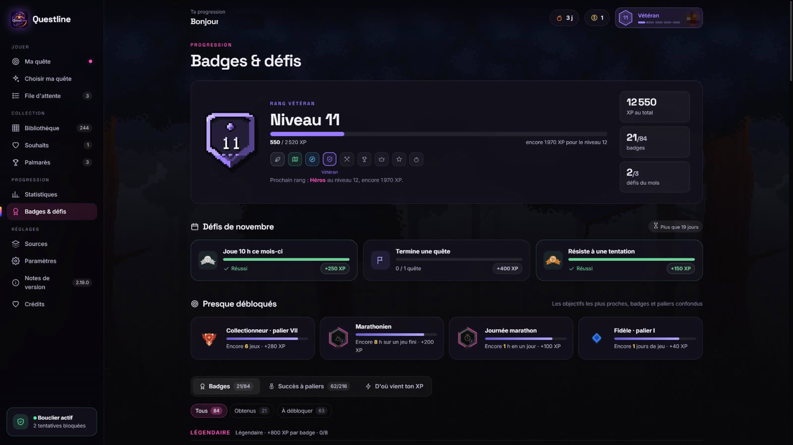
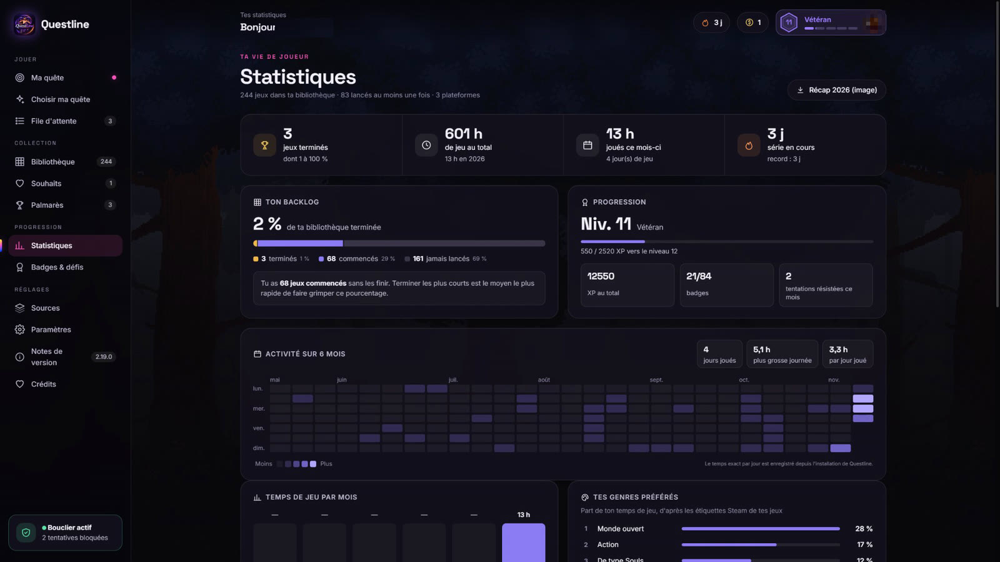

<p align="center"></p>

<p align="center">
  <a href="../../releases/latest"></a>
  
  <a href="LICENSE"></a>
</p>

# Questline

**Un jeu. Jusqu'au générique.**

Tu as des centaines de jeux et tu n'en termines presque aucun ? Questline choisit avec toi le prochain jeu de ta bibliothèque, le lance, puis **bloque les autres téléchargements Steam** tant que l'histoire n'est pas terminée. La fin est détectée automatiquement grâce aux succès (Steam, Epic, ou sauvegarde du jeu pour certaines consoles émulées).

- **Choisir ma quête** : quelques questions sur ton envie et ton rythme, et Questline classe tes jeux selon tes chances d'aller au bout, avec le détail du score.
- **Toute ta collection réunie** : Steam (compte et famille), Epic, GOG, Ubisoft Connect, Amazon, jeux PC et consoles émulées, avec jaquettes, notes Metacritic, avis de la presse et des joueurs.
- **Une vraie progression** : date de fin estimée selon ton rythme, palmarès, statistiques, 84 badges, 216 paliers, défis du mois et décors pixel art à débloquer.
- **Achats mérités** : termine des jeux pour gagner le droit d'en acheter un nouveau dans ta liste de souhaits.
- **Respect de ta vie privée** : aucun mot de passe, aucun compte relié sans ton accord, rien n'est envoyé à un serveur de Questline.

<p align="center"><a href="../../releases/latest"><b>⬇ Télécharger Questline</b></a> &nbsp;·&nbsp; Windows (installeur ou portable) · macOS (Intel et Apple Silicon) · Linux (AppImage)</p>

| | |
|---|---|
|  |  |
| **Ta quête** : progression, date de fin, journal | **Choisir ma quête** : le top 5 des jeux que tu vas finir |
|  |  |
| **Fiche de jeu** : notes, avis, manette ou clavier | **Palmarès** : or, argent, bronze |
|  |  |
| **Badges & défis** : niveaux, paliers, défis du mois | **Statistiques** : temps de jeu, genres, activité |

## Sources de jeux

| Source | Ce que Questline lit | Succès |
|---|---|---|
| **Steam** | Bibliothèque complète (compte + famille), temps de jeu, jeux installés | Oui (fichiers locaux de Steam) |
| **Epic Games** | Bibliothèque du compte (cache du launcher), jeux installés (launcher Epic ou Heroic) | Oui, si les succès du profil Epic sont publics |
| **GOG** | Jeux installés (GOG Galaxy sous Windows, Heroic) | — |
| **Ubisoft Connect** | Jeux installés (registre Windows), lancement par le launcher | — |
| **Amazon Games** | Jeux installés via Heroic | — |
| **Jeux PC manuels** | N'importe quel exécutable | — |
| **Émulateurs** | Jeux de tes dossiers, lancés directement dans l'émulateur | Zelda BotW (lus dans la sauvegarde) |

Questline n'a besoin d'aucun mot de passe : elle lit les fichiers que tes launchers laissent sur ton ordinateur.

## Consoles émulées

| Console | Émulateurs | Fichiers |
|---|---|---|
| Nintendo Switch | Eden / Eglantine, Citron, Sudachi, yuzu, Ryujinx | .nsp .xci .nsz .xcz |
| Nintendo Switch 2 | Eden / Eglantine | .nup .nsp .xci |
| Wii U | Cemu | .wud .wux .wua .rpx (et dossiers extraits) |
| Wii / GameCube | Dolphin | .wbfs .rvz .iso .gcz .ciso .wad |
| 3DS / DS | Azahar (Lime3DS, Citra), melonDS | .3ds .cci .cia / .nds |
| PlayStation 1 / 2 / 3 / PSP / 4 | DuckStation, PCSX2, RPCS3, PPSSPP, shadPS4 | .cue .chd .m3u / .iso .chd / dossiers PS3_GAME / .iso .cso / dossiers eboot.bin |
| Xbox 360 | Xenia Canary | .iso .xex .zar |
| Rétro (NES, SNES, N64, GB/GBC/GBA, Mega Drive, Dreamcast) | RetroArch (cœurs mesen, snes9x, mupen64plus_next, mgba, genesis_plus_gx, flycast…) | extensions habituelles |

Ajout d'un émulateur : **Sources > Ajouter un émulateur**. Choisis la console, l'émulateur (détection automatique ou « Parcourir… ») et tes dossiers de jeux. Les mises à jour et DLC Switch sont ignorés, les jeux PS1 multi-disques regroupés par leur `.m3u`.

### Jaquettes automatiques

1. Icône locale de l'émulateur (Switch)
2. [titledb](https://github.com/blawar/titledb) puis le site Nintendo Europe (Switch / Switch 2)
3. [GameTDB](https://www.gametdb.com) (Wii / GameCube, si le nom de fichier contient l'identifiant du jeu, ex. `[RMGE01]`)
4. [libretro-thumbnails](https://github.com/libretro-thumbnails) (rétro, PlayStation, Xbox 360…)
5. [SteamGridDB](https://www.steamgriddb.com) pour tout le reste, avec une clé API gratuite à saisir dans Sources

Les images sont téléchargées une fois puis gardées en cache.

## Installation

Télécharge la dernière version dans [Releases](../../releases) :

- **Windows** : `Questline-Setup-x.y.z.exe` (installeur) ou `Questline-x.y.z-portable.exe`
- **Linux** : `Questline-x.y.z.AppImage` (`chmod +x` puis lance-le)
- **macOS** : `Questline-x.y.z-arm64.dmg` (Apple Silicon) ou `-x64.dmg` (Intel). L'app n'est pas signée : au premier lancement, clic droit > Ouvrir.

Questline reste dans la zone de notification : fermer la fenêtre garde le bouclier actif. « Quitter » dans le menu de l'icône l'arrête.

## Données

- Windows : `%APPDATA%\Questline`
- Linux : `~/.config/Questline`
- macOS : `~/Library/Application Support/Questline`

Variable `QUESTLINE_DATA_DIR` : autre dossier de données (version portable, tests).

Services contactés, tous publics et sans compte : magasin et communauté Steam (fiches, tags, avis, profils publics), API GraphQL d'Epic (succès), Wikipédia et Wikidata (notes de la presse), titledb, Nintendo Europe, GameTDB, libretro-thumbnails, SteamGridDB (si clé fournie).

Sécurité : voir [SECURITY.md](SECURITY.md) (audit, indicateurs et signalement d'une faille).

## Développement

```bash
npm install
npm start        # lance l'app
npm test         # tests des lecteurs de formats
npm run dist     # construit l'exécutable du système courant
```

Les exécutables des trois systèmes sont construits par GitHub Actions (`.github/workflows/build.yml`) à chaque tag `v*` et publiés dans une release.

Structure :

```
electron/        processus principal (fenêtre, zone de notification, sélecteurs de fichiers)
src/server.js    serveur local 127.0.0.1 + API de l'interface
src/platforms/   Steam, Epic, GOG, Amazon / jeux manuels
src/emulation/   catalogue des consoles, scan des jeux, jaquettes, Switch
src/guard.js     bouclier (limite de jeux installés), fin de quête, journal
static/          interface
```

## Limites connues

- Bouclier : seuls les téléchargements **Steam** sont bloqués.
- Succès Epic : lisibles uniquement si ton profil Epic rend les succès publics.
- Succès des jeux émulés : seulement Zelda BotW pour l'instant (format de sauvegarde vérifié). Les autres jeux se valident sur l'honneur.
- macOS : aucune signature Apple, d'où l'avertissement au premier lancement.

## Licence

Code sous licence [MIT](LICENSE). Polices (SIL OFL 1.1), illustrations (CC0) et composants d'interface (MIT) : voir [THIRD_PARTY_NOTICES.md](THIRD_PARTY_NOTICES.md).

Questline ne fournit et ne télécharge aucun jeu, BIOS ou clé : utilise uniquement des copies de jeux que tu possèdes.

Questline est un projet indépendant, sans lien avec Valve, Epic Games, GOG, Ubisoft, Amazon, Nintendo, Sony ou Microsoft, ni approuvé par eux. Les noms et marques cités appartiennent à leurs propriétaires.
